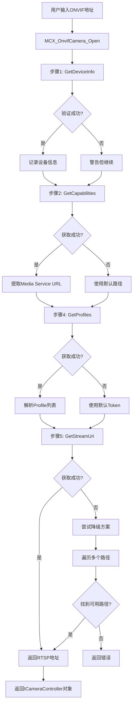

# ONVIF 标准协议流程图

## 完整流程概览



## 详细步骤说明

### 步骤1: GetDeviceInfo (设备验证)

**目的**: 验证设备可达性和认证信息正确性

**SOAP请求**:

```xml
<?xml version="1.0" encoding="UTF-8"?>
<s:Envelope xmlns:s="http://www.w3.org/2003/05/soap-envelope"
            xmlns:tds="http://www.onvif.org/ver10/device/wsdl"
            xmlns:wsse="http://docs.oasis-open.org/wss/2004/01/oasis-200401-wss-wssecurity-secext-1.0.xsd">
  <s:Header>
    <wsse:Security s:mustUnderstand="1">
      <wsse:UsernameToken>
        <wsse:Username>admin</wsse:Username>
        <wsse:Password Type="...#PasswordText">password</wsse:Password>
      </wsse:UsernameToken>
    </wsse:Security>
  </s:Header>
  <s:Body>
    <tds:GetDeviceInformation/>
  </s:Body>
</s:Envelope>
```

**测试路径**:

- `/onvif/device_service`
- `/onvif/device`
- `/cgi-bin/onvif/device_service`
- `/device_service`
- `/onvif/services`

**响应示例**:

```xml
<tds:GetDeviceInformationResponse>
    <tds:Manufacturer>Hikvision</tds:Manufacturer>
    <tds:Model>DS-2CD3T46G2-L</tds:Model>
    <tds:FirmwareVersion>V5.7.5 build 210325</tds:FirmwareVersion>
    <tds:SerialNumber>DS-2CD3T46G2-L20210325AACHJ12345678</tds:SerialNumber>
    <tds:HardwareId>0x00000001</tds:HardwareId>
</tds:GetDeviceInformationResponse>
```

**容错策略**:

- 如果失败，记录警告但继续后续步骤
- 有些老旧设备可能不支持此API

---

### 步骤2: GetCapabilities (获取服务能力)

**目的**: 获取设备支持的所有服务列表

**SOAP请求**:

```xml
<?xml version="1.0" encoding="UTF-8"?>
<s:Envelope xmlns:s="http://www.w3.org/2003/05/soap-envelope"
            xmlns:tds="http://www.onvif.org/ver10/device/wsdl"
            xmlns:wsse="http://docs.oasis-open.org/wss/2004/01/oasis-200401-wss-wssecurity-secext-1.0.xsd">
  <s:Header>
    <wsse:Security s:mustUnderstand="1">
      <wsse:UsernameToken>
        <wsse:Username>admin</wsse:Username>
        <wsse:Password Type="...#PasswordText">password</wsse:Password>
      </wsse:UsernameToken>
    </wsse:Security>
  </s:Header>
  <s:Body>
    <tds:GetCapabilities/>
  </s:Body>
</s:Envelope>
```

**响应示例**:

```xml
<tds:GetCapabilitiesResponse>
    <tds:Capabilities>
        <tt:Media>
            <tt:XAddr>http://192.168.1.100/onvif/Media</tt:XAddr>
        </tt:Media>
        <tt:PTZ>
            <tt:XAddr>http://192.168.1.100/onvif/PTZ</tt:XAddr>
        </tt:PTZ>
        <tt:Events>
            <tt:XAddr>http://192.168.1.100/onvif/Events</tt:XAddr>
        </tt:Events>
    </tds:Capabilities>
</tds:GetCapabilitiesResponse>
```

**关键信息**: 提取 `<tt:XAddr>` 作为 Media Service URL

---

### 步骤3: 提取 Media Service URL

从GetCapabilities响应中解析出Media服务的完整URL：

```
http://192.168.1.100/onvif/Media
```

如果无法获取，使用默认路径：

```
http://192.168.1.100:80/onvif/media_service
```

---

### 步骤4: GetProfiles (获取媒体配置)

**目的**: 获取所有可用的媒体配置文件（主码流、子码流等）

**SOAP请求**:

```xml
<?xml version="1.0" encoding="UTF-8"?>
<s:Envelope xmlns:s="http://www.w3.org/2003/05/soap-envelope"
            xmlns:trt="http://www.onvif.org/ver10/media/wsdl"
            xmlns:wsse="http://docs.oasis-open.org/wss/2004/01/oasis-200401-wss-wssecurity-secext-1.0.xsd">
  <s:Header>
    <wsse:Security s:mustUnderstand="1">
      <wsse:UsernameToken>
        <wsse:Username>admin</wsse:Username>
        <wsse:Password Type="...#PasswordText">password</wsse:Password>
      </wsse:UsernameToken>
    </wsse:Security>
  </s:Header>
  <s:Body>
    <trt:GetProfiles />
  </s:Body>
</s:Envelope>
```

**测试路径** (如果步骤2失败):

- `/onvif/Media`
- `/onvif/media`
- `/onvif/media_service`
- `/cgi-bin/onvif/media_service`
- `/media_service`
- ... (共18个路径)

**响应示例**:

```xml
<trt:GetProfilesResponse>
    <trt:Profiles token="Profile_1" fixed="true">
        <tt:Name>MainStream</tt:Name>
        <tt:VideoSourceConfiguration>...</tt:VideoSourceConfiguration>
        <tt:VideoEncoderConfiguration>
            <tt:Encoding>H264</tt:Encoding>
            <tt:Resolution>
                <tt:Width>1920</tt:Width>
                <tt:Height>1080</tt:Height>
            </tt:Resolution>
        </tt:VideoEncoderConfiguration>
    </trt:Profiles>
    <trt:Profiles token="Profile_2" fixed="false">
        <tt:Name>SubStream</tt:Name>
        ...
    </trt:Profiles>
</trt:GetProfilesResponse>
```

**解析结果**:

```
Profiles: ["Profile_1", "Profile_2"]
```

---

### 步骤5: GetStreamUri (获取RTSP地址)

**目的**: 对每个Profile获取对应的RTSP流地址

**SOAP请求** (以Profile_1为例):

```xml
<?xml version="1.0" encoding="UTF-8"?>
<s:Envelope xmlns:s="http://www.w3.org/2003/05/soap-envelope"
            xmlns:trt="http://www.onvif.org/ver10/media/wsdl"
            xmlns:tt="http://www.onvif.org/ver10/schema"
            xmlns:wsse="http://docs.oasis-open.org/wss/2004/01/oasis-200401-wss-wssecurity-secext-1.0.xsd">
  <s:Header>
    <wsse:Security s:mustUnderstand="1">
      <wsse:UsernameToken>
        <wsse:Username>admin</wsse:Username>
        <wsse:Password Type="...#PasswordText">password</wsse:Password>
      </wsse:UsernameToken>
    </wsse:Security>
  </s:Header>
  <s:Body>
    <trt:GetStreamUri>
      <trt:StreamSetup>
        <tt:Stream>RTP-Unicast</tt:Stream>
        <tt:Transport>
          <tt:Protocol>RTSP</tt:Protocol>
        </tt:Transport>
      </trt:StreamSetup>
      <trt:ProfileToken>Profile_1</trt:ProfileToken>
    </trt:GetStreamUri>
  </s:Body>
</s:Envelope>
```

**响应示例**:

```xml
<trt:GetStreamUriResponse>
    <trt:MediaUri>
        <tt:Uri>rtsp://192.168.1.100:554/h264/ch1/main/av_stream</tt:Uri>
        <tt:InvalidAfterConnect>false</tt:InvalidAfterConnect>
        <tt:InvalidAfterReboot>false</tt:InvalidAfterReboot>
        <tt:Timeout>PT60S</tt:Timeout>
    </trt:MediaUri>
</trt:GetStreamUriResponse>
```

**最终结果**:

```
RTSP Stream URI: rtsp://192.168.1.100:554/h264/ch1/main/av_stream
```

---

## 降级策略

### 多层Fallback机制

```
标准流程失败
    ↓
┌─────────────────────────────────┐
│ 降级方案1: 尝试其他路径          │
│ - 测试25个常见ONVIF路径         │
│ - HTTP + HTTPS                  │
└──────────────┬──────────────────┘
               ↓ 失败
┌─────────────────────────────────┐
│ 降级方案2: 通用Profile Token    │
│ - Profile_1                     │
│ - profile1                      │
│ - MainStream                    │
│ - main                          │
│ - stream1                       │
│ - channel1                      │
└──────────────┬──────────────────┘
               ↓ 失败
┌─────────────────────────────────┐
│ 降级方案3: RTSP模板猜测         │
│ - 根据品牌生成特定格式          │
│ - Hikvision: /h264/ch1/...     │
│ - Dahua: /cam/realmonitor?...  │
│ - Axis: /axis-media/...        │
└──────────────┬──────────────────┘
               ↓ 失败
返回错误
```

---

## 错误处理

### 常见错误及解决方案

| 错误 | 原因 | 解决方案 |
|------|------|----------|
| HTTP 401 | 认证失败 | 检查用户名密码，确认ONVIF用户已启用 |
| HTTP 404 | 路径错误 | 尝试其他路径，使用高级检测功能 |
| HTTP 500 | 服务器内部错误 | 检查设备状态，重启ONVIF服务 |
| Timeout | 网络超时 | 检查网络连接，增加超时时间 |
| XML Parse Error | 响应格式错误 | 查看原始响应，联系厂商 |

---

## 性能优化

### 超时设置

- **GetDeviceInfo**: 3秒
- **GetCapabilities**: 3秒
- **GetProfiles**: 3秒
- **GetStreamUri**: 3秒
- **总超时**: 最多15秒（不含重试）

### 并发控制

- 路径测试按顺序进行（避免过多并发请求）
- 每个协议（HTTP/HTTPS）独立测试
- 找到第一个成功的路径后立即返回

---

## 日志示例

```
🔍 [camera_001] 步骤1: 验证设备可达性...
✅ [camera_001] 设备验证成功: Manufacturer=Hikvision, Model=DS-2CD3T46G2-L
🔍 [camera_001] 步骤2-3: 获取Media服务地址...
🔍 [camera_001] GetCapabilities 尝试: http://192.168.1.100:80/onvif/device_service
✅ [camera_001] GetCapabilities 成功，URL: http://192.168.1.100:80/onvif/device_service
📍 [camera_001] 解析到 Media 服务地址: http://192.168.1.100/onvif/Media
✅ [camera_001] 获取到 Media 服务地址: http://192.168.1.100/onvif/Media
🔍 [camera_001] 步骤4: 获取Profile列表...
🔄 [camera_001] 尝试 GetProfiles 降级路径: http://192.168.1.100:80/onvif/Media
✅ [camera_001] GetProfiles 降级成功，路径: /onvif/Media
✅ [camera_001] 获取到 2 个Profile，使用第一个: Profile_1
🔍 [camera_001] 步骤5: 获取RTSP流地址...
🎬 [camera_001] 使用指定的 Media URL: http://192.168.1.100/onvif/Media 和 Profile: Profile_1
✅ [camera_001] 获取流地址成功
✅ [camera_001] 解析到流地址: rtsp://192.168.1.100:554/h264/ch1/main/av_stream
```

---

## 相关文件

- **核心实现**: `tauri-app/src-tauri/src/ptz/onvif.rs`
- **Tauri命令**: `tauri-app/src-tauri/src/ptz_commands.rs`
- **前端界面**: `tauri-app/src/components/teacher-window/dialogs/AddSourceDialog.vue`
- **使用指南**: `ONVIF_DEVICE_DETECTION_GUIDE.md`

---

## 参考标准

- **ONVIF Core Specification**: <https://www.onvif.org/specs/core/>
- **ONVIF Media Service**: <https://www.onvif.org/specs/srv/media/>
- **ONVIF Device Service**: <https://www.onvif.org/specs/devicemgmt/>
- **WS-Security**: <https://docs.oasis-open.org/wss/>
